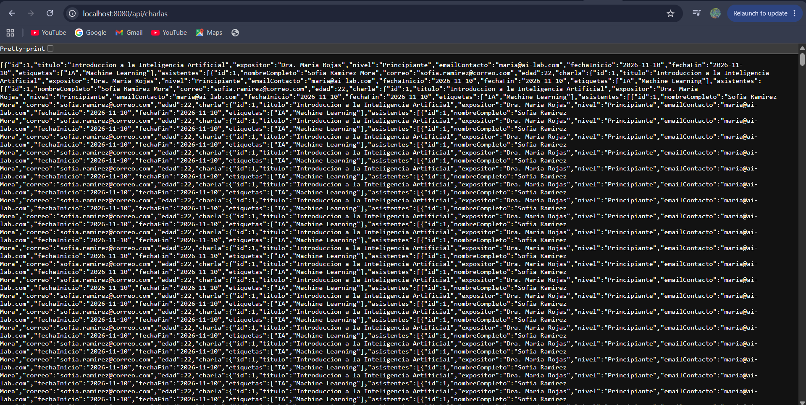

# TechConf — Laboratorio 12: Proyecto Full-Stack Autónomo

| | |
|---|---|
| **Estudiante** | Debora Zavala Nuñez |
| **Carné** | C5L189 |
| **Curso** | IF0009 - Desarrollo de Software IV |
| **Profesor** | Mag. Jonathan Granados C. |
| **Institución** | Universidad de Costa Rica, Sede del Atlántico, Recinto Paraíso |
| **Semestre** | II-2026 |

---

## Tabla de contenido

1. [Descripción](#1-descripción)
2. [Estructura del repositorio](#2-estructura-del-repositorio)
3. [Stack tecnológico](#3-stack-tecnológico)
4. [Cómo ejecutar el proyecto](#4-cómo-ejecutar-el-proyecto)
5. [Back-End](#5-back-end)
6. [Front-End](#6-front-end)
7. [Validaciones](#7-validaciones)
8. [Parte 2: Análisis y depuración de la recursión infinita](#8-parte-2-análisis-y-depuración-de-la-recursión-infinita)
9. [Control de versiones](#9-control-de-versiones)

---

## 1. Descripción

TechConf es un sistema de registro de charlas para una conferencia tecnológica. Esta versión integra lo construido en las Prácticas 11.a y 11.b y lo expande con:

- Una nueva entidad **`Asistente`** y una relación **1:N bidireccional** con `Charla`.
- Un endpoint para **inscribir asistentes** en una charla.
- Un **formulario reactivo de inscripción** dentro de cada tarjeta de la agenda, con validador personalizado de edad.
- Registro de charlas con **etiquetas dinámicas** (`FormArray`) y **validación cruzada de fechas**.

---

## 2. Estructura del repositorio

```
IF0009-Lab12-C5L189/
├── README.md
├── docs/
│   └── error_recursion.png
├── techconf-backend/
│   └── src/main/
│       ├── java/com/techconf/
│       │   ├── controllers/   CharlaController
│       │   ├── models/        Charla, Asistente
│       │   ├── repositories/  CharlaRepository, AsistenteRepository
│       │   └── exceptions/    GlobalExceptionHandler, ResourceNotFoundException
│       └── resources/         application.properties, data.sql
└── techconf-frontend/
    └── src/app/
        ├── components/
        │   ├── charla-registro/   Formulario de charla + agenda
        │   └── asistente-form/    Formulario de inscripción
        ├── validators/            rango-fechas.validator.ts, edad.validator.ts
        ├── services/              charla.service.ts
        └── models/                charla.model.ts
```

---

## 3. Stack tecnológico

| Capa | Tecnología |
|---|---|
| Back-End | Java 17+, Spring Boot 3.2.5, Spring Data JPA (Hibernate 6), Bean Validation |
| Base de datos | H2 en memoria |
| Front-End | Angular 19 Standalone, Reactive Forms tipados, RxJS |

---

## 4. Cómo ejecutar el proyecto

### Back-End

```bash
cd techconf-backend
mvn spring-boot:run
```

- API: `http://localhost:8080/api/charlas`
- Consola H2: `http://localhost:8080/h2-console`
  (JDBC URL `jdbc:h2:mem:techconfdb`, usuario `sa`, contraseña `password`)

### Front-End

```bash
cd techconf-frontend
npm install
npx ng serve
```

Aplicación: `http://localhost:4200`

---

## 5. Back-End

### 5.1 Modelo de datos

| Tabla | Columnas |
|---|---|
| `CHARLA` | `id`, `titulo`, `expositor`, `nivel`, `email_contacto`, `fecha_inicio`, `fecha_fin` |
| `CHARLA_ETIQUETAS` | `charla_id`, `etiqueta` (generada por `@ElementCollection`) |
| `ASISTENTE` | `id`, `nombre_completo`, `correo`, `edad`, `charla_id` (FK a `CHARLA`) |

### 5.2 Relación bidireccional `@OneToMany` / `@ManyToOne`

```java
// Charla.java  (lado "uno")
@OneToMany(mappedBy = "charla", cascade = CascadeType.ALL, orphanRemoval = true)
private List<Asistente> asistentes = new ArrayList<>();

// Asistente.java  (lado "muchos", dueño de la llave foránea)
@JsonIgnore
@ManyToOne(fetch = FetchType.LAZY, optional = false)
@JoinColumn(name = "charla_id", nullable = false)
private Charla charla;
```

- `Asistente` es el **lado propietario** de la relación (tiene la columna `charla_id`); `Charla` usa `mappedBy`.
- Al consultar una charla, la respuesta incluye su lista `asistentes`. El lado inverso (`Asistente.charla`) se excluye del JSON con `@JsonIgnore` para evitar la recursión infinita (ver [sección 8](#8-parte-2-análisis-y-depuración-de-la-recursión-infinita)).

### 5.3 Datos semilla (`data.sql`)

Se insertan 3 charlas, 7 etiquetas y **7 asistentes** repartidos entre las tres charlas. En `application.properties` se activa `spring.jpa.defer-datasource-initialization=true` para que `data.sql` se ejecute **después** de que Hibernate cree las tablas.

### 5.4 Endpoints

| Método | Ruta | Descripción | Respuesta |
|---|---|---|---|
| `GET` | `/api/charlas` | Lista todas las charlas con etiquetas y asistentes | `200` |
| `GET` | `/api/charlas/{id}` | Detalle de una charla | `200` / `404` |
| `POST` | `/api/charlas` | Registra una charla | `201` / `400` |
| `POST` | `/api/charlas/{id}/asistentes` | Inscribe un asistente en la charla | `201` / `400` / `404` |

Ejemplo de cuerpo para `POST /api/charlas/1/asistentes`:

```json
{
  "nombreCompleto": "Ana Mora Rojas",
  "correo": "ana.mora@correo.com",
  "edad": 24
}
```

### 5.5 Manejo de errores

`GlobalExceptionHandler` (`@RestControllerAdvice`) devuelve respuestas JSON consistentes:

| Situación | Código |
|---|---|
| Datos inválidos (Bean Validation) | `400` con un mapa `errores` por campo |
| JSON mal formado o regla de negocio incumplida (p. ej. fecha de fin anterior al inicio) | `400` |
| Charla inexistente | `404` |

---

## 6. Front-End

### 6.1 Formulario de charlas (Práctica 11.b)

- `FormGroup` tipado con `NonNullableFormBuilder`.
- **`FormArray`** para las etiquetas: el botón "+ Añadir otra etiqueta" agrega campos y la "X" los elimina (siempre queda al menos uno).
- **Validador cruzado** `validarRangoFechas` aplicado al `FormGroup`: marca `fechasInvalidas` si la fecha de fin es anterior a la de inicio, muestra un mensaje global y deshabilita "Guardar Charla".

### 6.2 Formulario de inscripción de asistentes (Laboratorio 12)

Cada tarjeta de la agenda tiene un botón **"Inscribir Asistente"** que despliega el componente `AsistenteFormComponent`, un `FormGroup` tipado con:

| Campo | Validaciones |
|---|---|
| `nombre` | Requerido, longitud mínima de 3 caracteres |
| `correo` | Requerido, formato de email válido |
| `edad` | Requerido, **validador personalizado** `mayorDeEdadValidator`, máximo 120 |

```ts
export const mayorDeEdadValidator: ValidatorFn = (control: AbstractControl): ValidationErrors | null => {
  const valor = control.value;
  if (valor === null || valor === undefined || valor === '') return null;
  const edad = Number(valor);
  if (Number.isNaN(edad)) return { edadInvalida: true };
  return edad >= EDAD_MINIMA ? null : { menorDeEdad: { requerida: EDAD_MINIMA, actual: edad } };
};
```

> El validador considera válidas las edades **de 18 años en adelante** (mayoría de edad). La constante `EDAD_MINIMA` se encuentra en `validators/edad.validator.ts`.

Al enviar un formulario válido:

1. `CharlaService.inscribirAsistente()` hace `POST /api/charlas/{id}/asistentes`.
2. El servidor devuelve el asistente creado (`201`).
3. La tarjeta se actualiza al instante con el nuevo asistente y el contador de inscritos.
4. Si el servidor responde con errores de validación (`400`), se muestran dentro del formulario.

---

## 7. Validaciones

Todos los datos se validan en **ambos lados**: el Front-End da retroalimentación inmediata y el Back-End nunca confía en el cliente.

| Dato | Front-End (Angular) | Back-End (Bean Validation) |
|---|---|---|
| Nombre del asistente | `required`, `minLength(3)` | `@NotBlank`, `@Size(min = 3, max = 120)` |
| Correo | `required`, `email` | `@NotBlank`, `@Email` |
| Edad | `required`, `mayorDeEdadValidator`, `max(120)` | `@NotNull`, `@Min(18)`, `@Max(120)` |
| Título de charla | `required`, `minLength(5)` | `@NotBlank`, `@Size(min = 5)` |
| Fechas de la charla | `required` + validador cruzado | `@NotNull` + comprobación en el controlador |
| Etiquetas | `FormArray` con `required` | `@NotEmpty` y limpieza de valores en blanco |

---

## 8. Parte 2: Análisis y depuración de la recursión infinita

### 8.1 Qué se hizo

Se provocó intencionalmente el error eliminando la protección de la relación bidireccional y se consultó `GET /api/charlas`.

**Evidencia:**



### 8.2 Causa del problema

La relación es bidireccional:

```
Charla ──asistentes──▶ Asistente ──charla──▶ Charla ──asistentes──▶ Asistente ...
```

Al serializar una `Charla`, Jackson recorre su lista `asistentes`; para cada `Asistente` recorre su propiedad `charla`, que apunta de vuelta a la misma `Charla`, y vuelve a recorrer `asistentes`, y así sucesivamente. El ciclo nunca termina hasta desbordar la pila de llamadas (`StackOverflowError`).

Síntomas observados:

- El navegador (o Postman) recibe un **error HTTP 500**.
- En la consola de Spring Boot aparece una excepción `HttpMessageNotWritableException` cuyo mensaje es similar a `Could not write JSON: Infinite recursion (StackOverflowError)`, con una cadena de referencias que alterna `Charla["asistentes"]` y `Asistente["charla"]`.

### 8.3 Procedimiento aplicado para resolverlo

1. **Identificar el ciclo:** en la cadena de referencias del error se repiten `Charla["asistentes"]` y `Asistente["charla"]`, lo cual indica que el problema está en la relación bidireccional entre ambas entidades.
2. **Decidir el lado que se debe omitir:** el JSON de una charla necesita sus asistentes (requisito del laboratorio), pero el JSON de un asistente no necesita repetir la charla completa. Por lo tanto, se omite el lado "muchos" (`Asistente.charla`).
3. **Aplicar `@JsonIgnore`** sobre el atributo `charla` de `Asistente`:

   ```java
   @JsonIgnore
   @ManyToOne(fetch = FetchType.LAZY, optional = false)
   @JoinColumn(name = "charla_id", nullable = false)
   private Charla charla;
   ```
4. **Reiniciar** el back-end y volver a ejecutar `GET /api/charlas`: ahora responde `200 OK` con cada charla y su arreglo `asistentes`, sin la propiedad `charla` dentro de cada asistente.
5. **Verificar** que el `POST /api/charlas/{id}/asistentes` sigue funcionando: `@JsonIgnore` solo afecta la conversión a JSON; el vínculo se establece en el servidor con `asistente.setCharla(charla)`, de modo que la llave foránea `charla_id` se guarda correctamente.

### 8.4 Directivas de Jackson utilizadas

| Directiva | Uso en este proyecto |
|---|---|
| **`@JsonIgnore`** | Aplicada en `Asistente.charla`. Excluye la propiedad al serializar y deserializar, rompiendo el ciclo. **Es la solución adoptada.** |

Alternativas válidas que no se utilizaron:

| Directiva | Descripción |
|---|---|
| `@JsonManagedReference` / `@JsonBackReference` | Par de anotaciones: el lado "managed" se serializa y el lado "back" se omite. |
| `@JsonIgnoreProperties("charla")` | Se coloca en la lista `asistentes` para omitir solo esa propiedad dentro de los elementos. |
| `@JsonIdentityInfo` | Reemplaza las repeticiones por una referencia al `id` del objeto ya serializado. |
| **DTOs** | Devolver objetos de transferencia en lugar de entidades JPA; es la opción más robusta en proyectos grandes. |

Se eligió `@JsonIgnore` por ser la más simple y por ajustarse al requerimiento: la charla expone sus asistentes y el asistente no repite la charla.

### 8.5 Otros errores HTTP frecuentes en este tipo de proyecto

| Error | Causa habitual | Solución |
|---|---|---|
| `415 Unsupported Media Type` | El `POST` se envía sin `Content-Type: application/json` | Agregar la cabecera correcta en el cliente |
| `400 Bad Request` | JSON mal formado o datos que incumplen las validaciones | Revisar el cuerpo; el mensaje del servidor indica el campo |
| `404 Not Found` | `id` de charla inexistente en `/api/charlas/{id}/asistentes` | Usar un `id` existente |
| Error de CORS en el navegador | El origen del Front-End no está permitido | `@CrossOrigin(origins = "http://localhost:4200")` en el controlador |

---

## 9. Control de versiones

El repositorio se construyó con commits atómicos y descriptivos, siguiendo la convención `tipo(ámbito): descripción` (`feat`, `fix`, `docs`, `chore`, `debug`). El historial incluye el commit que provoca el error de recursión (`debug`) y el commit que lo corrige (`fix`).
